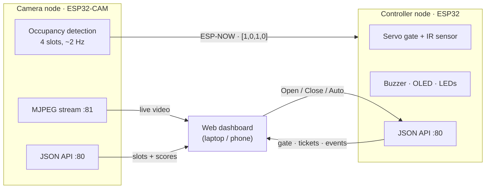

# Smart Parking System

A camera-based parking monitor built on two ESP32 boards and a web dashboard.

An **ESP32-CAM** watches four parking slots and works out which are free *on the board itself*.
It sends the result to an **ESP32 controller** over ESP-NOW, which runs the entry gate, buzzer
and OLED. A **React dashboard** on any laptop or phone shows the live video, the slots, the
gate, tickets and history.

There is no cloud, no Python and no internet required: the camera creates its own Wi-Fi.



All devices join the Wi-Fi network **`ParkingCam`** (password `park1234`) created by the ESP32-CAM.

## Features

- **On-device vision.** Background subtraction with Gaussian smoothing, brightness correction,
  hysteresis and debouncing, running on the ESP32-CAM.
- **Fast board-to-board link.** Slot states reach the controller over ESP-NOW in a few
  milliseconds, with no router involved.
- **Gate control.** The entry IR sensor opens the servo barrier only when a slot is free; the
  dashboard can switch the gate between *Auto*, *Open* and *Closed*.
- **Live dashboard.**
  - Live video with **Raw / Difference / Mask** views of the detection pipeline
  - Slot map, occupancy timeline and activity log
  - Tickets with fees, and a phone ticket page opened from a QR code
- **Any number of nodes.** Cameras and controllers are added by IP in *Settings → Nodes*.
- **Demo mode.** A built-in simulator runs the whole dashboard without any hardware.

## Repository layout

| Path | What it is |
|---|---|
| [`firmware/esp32cam/`](firmware/esp32cam/) | Camera node: detection, video stream, Wi-Fi access point, API |
| [`firmware/esp32/`](firmware/esp32/) | Controller node: gate, IR, buzzer, OLED, LEDs, tickets, API (classic ESP32 **or** ESP32-S3) |
| [`firmware/cam_stream_test/`](firmware/cam_stream_test/) | Minimal camera-only stream, for checking the camera and Wi-Fi |
| [`firmware/servo_test/`](firmware/servo_test/) | Moves the servo once, for checking the gate wiring |
| [`dashboard/`](dashboard/) | Web dashboard (Vite, React, TypeScript, Tailwind CSS) |
| [`docs/`](docs/) | Hardware, API, algorithm and troubleshooting guides |

## Quick start

### 1. Try the dashboard without hardware

You need [Node.js 18+](https://nodejs.org). The same commands work on macOS, Linux, and Windows
(Command Prompt or PowerShell).

```bash
cd dashboard
npm install
npm run dev:mock
```

Open http://localhost:5173. Everything is simulated: cars arrive, the gate opens, tickets are paid.

### 2. Hardware

| Part | Notes |
|---|---|
| ESP32-CAM (AI-Thinker, OV2640 or OV3660) + ESP32-CAM-MB programmer | Powered from a 5 V 2 A power bank or charger |
| ESP32 dev board (classic or S3) | Controller |
| SG90 servo, IR obstacle sensor, buzzer, SSD1306 OLED (0.96″ I²C) | LEDs are optional |

Wiring tables for both controller boards are in **[docs/HARDWARE.md](docs/HARDWARE.md)**.

### 3. Flash the boards

1. **Install the board package.** Install [Arduino IDE 2](https://www.arduino.cc/en/software). In
   *Settings → Additional boards manager URLs*, add
   `https://espressif.github.io/arduino-esp32/package_esp32_index.json`. Then install
   **esp32 by Espressif Systems** from Boards Manager.
2. **Install the libraries** with Library Manager:
   - **ArduinoJson** 7.x
   - **ESP Async WebServer** and **Async TCP**, both by **ESP32Async**
   - **Adafruit SSD1306** (choose *Install all* for its dependencies)
   - **ESP32Servo**
3. **Flash the controller** with `firmware/esp32/esp32.ino`, using the settings below. The
   sketch picks the right pins for the selected board.

   | Board | Arduino *Board* setting | Other settings |
   |---|---|---|
   | Classic ESP32 | **ESP32 Dev Module** | — |
   | ESP32-S3 | **ESP32S3 Dev Module** | *USB CDC On Boot*: Enabled |
4. **Flash the camera** with `firmware/esp32cam/esp32cam.ino`:
   - Board: **AI Thinker ESP32-CAM**, Partition Scheme: **Huge APP**, PSRAM: **Enabled**.
   - If the upload fails with *Wrong boot mode*, hold **IO0**, tap **RST**, release IO0, and
     upload again.
5. **Power up** the camera with the parking area **empty**. It creates `ParkingCam`, saves an
   empty-lot reference, and blinks its red LED 3 times. The controller joins automatically
   and shows its IP on the OLED.

**Ports:**

| OS | Serial port name |
|---|---|
| macOS | `/dev/cu.usbserial-…` or `/dev/cu.usbmodem…` |
| Windows | `COM3`, `COM4`, … (check Device Manager → *Ports*) |

If no port appears, use a data USB cable and install the CP210x or CH340 driver for your board.

### 4. Run the dashboard with the real hardware

```bash
cd dashboard
npm install        # once, while you still have internet
npm start          # builds and serves on http://localhost:4173
```

1. Connect the laptop to **ParkingCam**, then open http://localhost:4173.
2. Go to **Settings → Nodes**. The camera is `192.168.4.1`; the controller is the IP shown on
   its OLED (usually `192.168.4.2`).
3. Both nodes turn **● Online**.

**Phones:** connect the phone to ParkingCam and open `http://<laptop-ip>:4173`. Find the laptop
IP with `ipconfig getifaddr en0` on macOS, or `ipconfig` on Windows (*Wireless LAN adapter Wi-Fi →
IPv4*). On Windows, allow Node.js through the firewall when asked.

### 5. Set up the demo lot

- Draw four slots on an A4 sheet.
- Mount the camera about **30 cm above** the sheet, pointing straight down, under even
  room light.
- Edit `SLOT_ROIS` in `esp32cam.ino` so each box covers one slot. Check the alignment at
  http://192.168.4.1:81/.
- Press **Settings → Recalibrate camera** with the sheet empty.

## Documentation

- **[docs/HARDWARE.md](docs/HARDWARE.md):** parts, wiring for classic ESP32 and ESP32-S3, power
- **[docs/HOW_IT_WORKS.md](docs/HOW_IT_WORKS.md):** detection algorithm, ESP-NOW, gate logic, tickets
- **[docs/API.md](docs/API.md):** HTTP endpoints of both nodes
- **[docs/TROUBLESHOOTING.md](docs/TROUBLESHOOTING.md):** upload, Wi-Fi, camera and dashboard problems
- **[dashboard/README.md](dashboard/README.md):** dashboard development

## Hosting the dashboard

The dashboard is a static site (`npm run build` → `dashboard/dist/`).

| Where | Live hardware? | Notes |
|---|---|---|
| **Laptop on ParkingCam** (`npm start`) | ✅ | Recommended. Phones can open it through the laptop's IP |
| Any static host (GitHub Pages, Vercel, Netlify) | Demo mode only | Browsers block an `https://` site from talking to `http://` devices on a local network. Add `?mock` to the URL for the simulator |

## Known limitations

- **One video viewer at a time.** The ESP32-CAM serves a single stream viewer.
- **No internet on ParkingCam.** Start the dashboard before joining it.
- **Session data is lost on reboot.** Tickets, events and history are kept in the controller's
  RAM and reset when it restarts.
- **Fixed camera position.** Moving the camera or the sheet requires recalibration.
